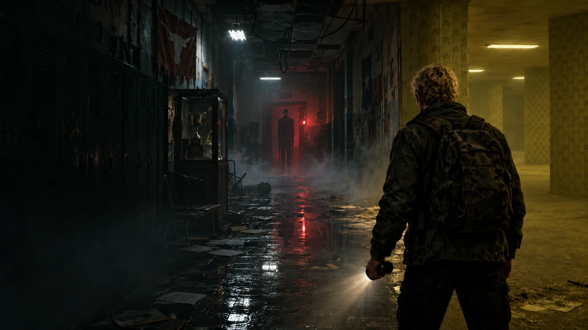

# Resident Espey: The Last Bell

**[Play on the web](https://caleb-guyer.github.io/resident-espey/)**

Some places remember you. Some refuse to let you go.

Version **5.5.4** culls fixed scenery proven hidden behind solid full-height walls, rejects unreachable wall lights per instance, and extends depth priming to fixed opaque planes. Native resolution, antialiasing, textures, lighting and shadow quality retain their existing settings. [1440p measurements and regression checks](PLAYTEST_5.5.4.md).

Version **5.5.3** reduces High-graphics overdraw with a fixed-architecture depth pass. Native 1440p testing reproduced approximately 45 FPS on the integrated test GPU and measured approximately 52–54 FPS with depth priming and identical captured images. Settings now shows the active graphics adapter and render resolution. [1440p measurements and verification](PLAYTEST_5.5.3.md).

Version **5.5.2** adds an FPS counter in the upper-right corner during gameplay and cutscenes, enabled by default. Settings → Show FPS counter saves your preference. It averages rendered game frames over half-second windows, accounts for skipped renders, and hides during menus, loading and pauses. Browser verification covers gameplay, the Settings toggle and paused flashbacks; all 278 tests pass.

Version **5.5.1** gives dense fixed scenery and wall trim smaller culling bounds, reducing submitted geometry in crowded rooms. Sculpt validation uses faster indexed reads and yields within large attributes. [Performance measurements and verification](PLAYTEST_5.5.1.md).

Version **5.5.0** rejects severed zombie triangles before rasterization, divides fixed walls into spatial batches, improves GPU vertex reuse in hands and bosses without removing geometry, compresses the prepared hand download, validates sculpt buffers in short loading tasks, and stops empty hazard-buffer uploads. [Optimization measurements and verification](PLAYTEST_5.5.md).

Version **5.4.2** reduces wall texture sampling and rejects out-of-range point lights before expensive lighting calculations. Chapter loading skips disposable copies of the licensed human rigs while retaining preparation of the actual story scenes. [Performance verification](PLAYTEST_5.4.2.md).

Version **5.4.1** replaces the production survivor bodies and projected portrait faces with six licensed, textured human rigs. Twenty-two facial shapes provide blinks, brows, gaze and articulated lips; speech follows recorded audio energy, with approximate text-based mouth shapes. Nine authored body clips blend movement, conversation and low poses. Ethan retains blonde curls and blue eyes; Earl retains a Black character model. Hand contact follows the imported wrists, and paused performance no longer accumulates offsets. [Character performance verification](PLAYTEST_5.4.md).

Version **5.3.0** gives all thirteen story scenes 75 authored shots: establishing views, consistent reverse angles, shoulder coverage, held reactions and inserts for important actions. Cameras follow the posed actors and props, keep clear of stage geometry, and retain their framing through dialogue gaps. Eyelines, blended pose changes, wrist-driven syringe contact and Earl's door brace strengthen the performances. Stage lighting has more contrast and photographed wall detail. Boss introductions gain new reveal moves, a steady off-camera key light and view-aware camera fitting. [Cinematic direction verification](PLAYTEST_5.3.md).

Version **5.2.1** reduces crowded-fight GPU work by skipping physical lighting for lights with exactly zero final contribution. Detailed boss bodies now have conservative culling bounds; fully off-screen bodies no longer submit their skin passes. Stationary blood uploads only when its pool changes, and transparent stain borders discard before expensive lighting. Shadows, textures, enemy counts and gore pool sizes remain intact. [Crowded combat verification](PLAYTEST_5.2.1.md).

Version **5.2.0** improves boss anticipation, attack follow-through, grounded movement, wing motion, introductions and distinct collapses. Shots produce directional torso, head and limb reactions layered over the existing animation; ordinary body hits keep locomotion clips running. Flesh impacts, melee confirmation and mixed-pellet headshot feedback are clearer. Dialogue coverage eases between speakers while preserving authored camera cuts. Prepared creature buffers and paced audio synthesis reduce cold-start CPU work, and a second small warm draw prepares final shadow variants before play. [Combat polish and performance verification](PLAYTEST_5.2.md).

Version **5.1.3** reduces excessive first-person mesh detail, preserves indexed vertices when batching rigid parts, and constructs weapons in loading stages. Matching zombie skin sections share one live skeleton, with independent snapshots for detached regions. Texture uploads yield in bounded batches, and warmup prepares the real game output once in a small viewport. [Startup and combat verification](PLAYTEST_5.1.3.md).

Version **5.1.2** fixes retained GPU instance buffers on retries, removes first-draw skeletal bounds scans, culls off-screen infected and detached parts, and caches procedural texture sources. Rendering uses a nonblocking queue limit to avoid submitting unbounded work when the GPU falls behind. Loading waits for warm uploads, and graphics interruptions preserve progress, prepare restored scenes and return control while paused. [Performance verification](PLAYTEST_5.1.2.md).

Version **5.1.0** rebuilds zombie combat around anatomical hit capsules and persistent injuries. All ten ordinary infected roles use the licensed textured skeletal model, with distinct proportions, poses, clothing and three resilience variations. Added screamers alert nearby enemies, armored infected resist body shots, and ferals accelerate when wounded. Regular health is substantially higher, with new supply caches to support the tougher fights.

Concentrated fire can sever either arm, either leg, or the head. Matching colour and shadow cuts expose flesh and bone, and the original textured limb keeps its frozen animation pose as it flies away. A lost leg cancels rushes and causes a limp; both lost legs force a crawl; losing both arms changes attacks to bites. Approximately 5% of infected have a stable, identity-based headless survival trait. They wander with limited nearby perception and can still be killed through body damage. Blood spray, floor splatter and detached parts use bounded pools and are prepared during loading. Health, injuries and valid positions survive checkpoint reloads. [5.1 verification](PLAYTEST_5.1.md).

Version **5.0.0** begins an artist-asset rebuild. Walkers and runners use Rikindle3D's licensed character, proper UV textures, and eleven imported motion clips with blended states, in-place locomotion and a lasting death pose. Boss faces use the artist's facial geometry, eyes and teeth with different head proportions; retired portrait and oral meshes stay hidden throughout speech and combat. Animated headshots follow the imported head bone.

Photographed plaster, chipped brick-backed walls, worn tiles and linoleum now use separate color, normal and roughness maps. Artist-made desks, utility cabinets, fire alarms and CCTV cameras replace or supplement room stand-ins while respecting the existing furniture and wall reservations. The title image is captured from the actual game environment. Source files, authors and licenses are tracked in [licensed art credits](LICENSED_ART.md). [5.0 verification](PLAYTEST_5.0.md).

This is a concrete move toward the requested production standard, not a claim of finished AAA parity. Bespoke boss bodies, weapon/hand rigs, survivor performances and human voice acting remain substantial production work.

Version **4.8.0** rebuilds the first-person hands with finer continuous surfaces and gradient normals, loaded from a prepared mesh asset before gameplay. The pistol slide, shotgun receiver, pump and stock, and carbine receiver, handguard and stock now use smooth tapered profiles. New original material surfaces add fine skin pores, worn blued steel and weathered plaster. Weapon light direction and intensity follow nearby room lamps and blackouts. Recoil, sights, reload timing and independent weapon ammunition remain intact.

Bosses have recessed three-dimensional eyes, irises, pupils and blinking lids, uneven discolored teeth, softer skin detail, and grounded two-link leg animation with a planted stance and lifted swing. Lil Birdy has a thinner torso; his enormous wings and both permanent tear-away phases remain. Service cabinets, cable looms, plumbing, valves and irregular wet floor reflections dress authored rooms without occupying thresholds. Finer floor tiles, varied fluorescent reflections and lower ambient light strengthen depth and contrast. [4.8 verification](PLAYTEST_4.8.md) · [Art assets and generation prompt](ART_4.8.md).

Version **4.7.1** improves handling and encounter clarity. Guns retract and rise when approaching a wall, then smoothly recover their sights as Ethan steps back. The reticle returns while the sights are lowered. The raised stance keeps the stock away from the camera, and sleeves remain anchored below the view throughout raised and reload poses. Crouching eases the camera between standing and crouched height; shots, muzzle flashes, brass and projectile hits use the current stance height. Metal surfaces now combine grain with varied roughness and softer worn highlights.

Creatures steer around nearby creatures during pursuit. Charges test their entire swept movement, including grazing hits. Injury lighting indicates the attack direction without another HUD panel, and projectiles retain their original attack direction. Boss projectiles respect a raised shutter's bottom edge and remaining panel. Introductions and phase movies clear prior hazards; defeating a boss clears its remaining projectiles, pools and waves. Decorative zero-damage effects cannot trigger injury feedback.

Boss cameras refit shots around furniture and shutters as well as walls, preserving the shot height where possible. A standing-height fallback keeps low shots out of obstructing furniture. Cinematic effects use the scene clock and remain frozen during pauses and audio preparation. [4.7 verification](PLAYTEST_4.7.md).

Version **4.6.1** fixes reload interruption, moving shutters, graphics changes and paused cutscenes. Magazine rounds transfer when seated and survive a dodge, melee attack or weapon switch; empty reloads keep the bolt open until chambering. Shotgun top-ups preserve the live round and skip the empty-reload pump cycle. Mixed pellet hits retain the body armor multiplier instead of granting headshot armor penetration to every pellet.

Shutter collision follows the visible opening, bullets and sight lines respect the raised bottom edge, and navigation refreshes when the opening becomes passable. Boss encounters begin sealing their arena before their introduction, and shutters continue moving during those sequences. Lil Birdy's wing clearance uses his full span.

Loading uploads hidden nested boss parts, including oral geometry. Graphics preset changes warm their rendering variants while gameplay and rendering are suspended; failed changes restore the old preset. Applying only audio/FOV settings keeps unchanged graphics buffers intact. Paused scenes redraw after resize and continue updating audio readiness/failure controls without submitting unchanged 3D frames. Ballistics and nearest-light selection avoid repeated temporary arrays and vectors. [4.6.1 verification](PLAYTEST_4.6.1.md).

Version **4.6.0** adds a pump shotgun and automatic carbine with independent ammunition, route pickups, keyboard/wheel/touch switching and compatible checkpoint storage. The shotgun fires eight distributed pellets with distance falloff, cycles its pump, ejects spent shells, and loads one shell at a time. Firing interrupts a shell reload while preserving loaded rounds. The carbine has a 30-round magazine, faster handling and separate bolt/magazine animation. All three sight lines settle at the reticle.

The sidearm now has a closed, chamfered slide, recessed ejection port, machining wear, detailed grip and improved skin and cloth materials. New original surface scans provide skin pores, scarring, metal grain and feather detail. Boss anatomy has subtler ribs, facial contours, rigged scars, tendon detail and mouths that open for speech and attacks. Black skin and brown hair character designs remain intact.

Lil Birdy begins with both enormous articulated wings. Ethan grabs and tears away the first at the third stage and the second before the grounded fourth stage. Two close-up sequences show the grip, strain, severing and falling wing; permanent stumps and dropped wings remain afterward. Removed wings lose their bullet hit volumes. His final stages retain the enraged charge, talons and scream patterns. Old phase checkpoints restore the corresponding wing state.

Weapon models, damaged wing variants, finisher hands, effects and shader variants are prepared during loading. Switching, shooting and wing removal reuse these resources. [4.6 verification](PLAYTEST_4.6.md) · [Texture source and generation prompt](ASSET_MATERIALS.md).

Version **4.5.1** fixes combat, checkpoints, menus and scene control. Point-blank shots connect inside head and limb hit volumes. Enemy phase speed applies equally in every direction, large creatures use consistent collision footprints, glancing wall impacts stop charges, and late charge/wave warnings show their actual range. Low furniture no longer hides a standing player from an enemy; navigation can approach someone standing beside a blocked cell. Settled corpses stop rebuilding their poses.

Lil Birdy now guards the last Backrooms fragment and must fall before Jakob's encounter begins. He grants the boss ammunition reward and saves his defeat without completing Jakob's fight. Boss checkpoints retain valid positions, alertness, damage and phases. Invalid optional save fields and damaged settings use safe defaults; retries save their death count. Focus loss keeps story and boss scenes paused, gameplay timers freeze during menus and scenes, new boss instructions become visible again, and a fatal hit cannot start another encounter.

Escape works from focused settings sliders, restores discarded audio previews, and returns nested menus to Pause consistently. Lost touch capture releases controls, overlapping loads are ignored, and unavailable Web Audio offers captions instead of blocking chapter preparation. The opening now leaves movement hints visible when play begins. [4.5.1 audit and verification](PLAYTEST_4.5.1.md).

Version **4.5.0** gives every boss five stages and substantially more health: Chris 1,800, Jakob & Bobby 2,200, Zeb 2,800 and Lil Birdy 1,500 before difficulty scaling. Each stage has its own attack combinations, tells and recovery windows. New stages cannot be skipped by burst damage before the boss attacks or Ethan creates an opening. Five small HUD pips show progress. Boss damage, broken parts, completed phase scenes and mechanism cooldowns persist in checkpoints.

Lil Birdy escalates from swoops and feather volleys to dives and a radial crosswind. A wing droops, then both wings crumple in a directed scene; he screams and fights on the ground with charges, talon combinations and a final frenzy. Jakob and Bobby force a chase through the Backrooms to an emergency press. Ethan must lure them beneath it and pull the lever. A piston fails: the tilted platen crushes Bobby's head and leaves Jakob alive. The scene returns to an enraged Jakob with heavier, chained charges; the HUD changes to **Jakob**. Shooting cannot bypass the trap, and pulling the lever too early allows another attempt.

Chris combines charges, backhands and ground tears; colliding with a wall or opening the steam vent exposes him. Zeb summons prepared reinforcements, casts spreading bile and ruptures a growth before filling the arena with haze. His siphon restores health unless interrupted; the purge switch clears hazards, suppresses the siphon and exposes him. Extra ammunition and first aid support the longer encounters. Arena shutters close only after Ethan and the boss enter, and reopen when the creature falls.

The performance pass caches and uploads the chapter's story stages and voice clips during loading, reuses hit geometry and hazard records, and moves checkpoint storage writes out of the immediate combat action. Creature screams are prepared once. Production gameplay no longer serializes a complete debug snapshot every frame. Background loading also has a bounded yield so browser frame throttling cannot stretch every preparation step. [4.5 playtest and limits](PLAYTEST_4.5.md).

Version **4.4.0** replaces all four boss presentations with bespoke sculpted bodies, photographic facial albedo, contoured facial anatomy, moving jaws, corneal highlights, fingers and claws. Jakob and Bobby now share one continuous skinned body with 21 bones, independent necks, four arms and four legs. Lil Birdy has layered, articulated primary and secondary feathers. Chris carries an asymmetric heavy forearm; Zeb has a hunched back and breathing growths. Smooth turns, distinct strides, distinct attack anticipation, follow-through, recovery and death poses replace the shared idle cycle. Anatomical capsules make shots on animated limbs connect.

Each boss has a unique voiced introduction in its actual arena: Chris's dragging claw, Jakob and Bobby waking separately, Zeb's heavy rise and shockwave, and Lil Birdy's wing reveal. Camera cuts, creature motion and recorded dialogue share a clock. Combat stops during the sequence; pause, skip and caption fallback work; the player receives a protected return to control. Introductions are remembered in the save so they do not repeat automatically. Packaged encounter dialogue and both rendering variants prepare during chapter loading.

Boss names are simply **Chris**, **Jakob & Bobby**, **Zeb**, and **Lil Birdy**. The HUD uses brief objectives and a chapter numeral; radio speaker names and the weapon label are shorter. Narrative flashback dates and location cues remain readable. Original boss facial texture atlas generated for this game; the source is saved in the repository.

Version **4.3.0** expands the campaign from 15 to 42 staged encounters and adds crawlers, spitters, armored brutes and flanking stalkers. The bosses have distinct committed attacks, visible tells, recovery windows and second phases: Chris crashes into walls, Jakob and Bobby alternate two fused bodies, Zeb casts bile and expanding ruptures, and Birdy swoops and sheds feather volleys. Headshots interrupt specific tells; targeting the speaking head silences the Joined. Temporary acid pools and shockwaves use bounded graphics batches and respect cover.

Birdy has thin brown hair and a 6.8-meter span of articulated, veined wings that fold through narrow passages. Earl and Zeb have Black skin tones, including their faces. Jakob has straight brown hair; Bobby has curly brown hair, with separate heads and four animated arms joined by scarred tissue. Character rigs and textures are cached, with independent bones and materials for every instance.

Chapter preparation yields between character builds and displays an explicit loading screen. The entire level, dormant creatures, reserved boss, both weapons and every attack effect upload before play; parallel shader compilation is used where available. The opening cinematic is prepared before its clock starts. Distant creatures skip expensive animation, and navigation searches have a per-frame budget. Existing 4.0+ objective, pickup and defeated-enemy IDs remain compatible; new supplies are appended.

Version **4.2.0** rebuilds the first-person pistol and hands: a contoured metal frame, open top slide, rounded barrel, cutout trigger guard, textured grip panels, continuous hand surfaces, knuckles, fingernails, and folded sleeves. Recoil uses a stable damped response; the slide and trigger cycle separately. Reloads show the support hand extracting, replacing, and seating the magazine, with a separate slide release for empty reloads. Aim settles to centered sights, movement sway fades when Ethan stops, and shot vibration no longer comes from random camera offsets.

Version **4.1.3** fixes firing while holding right-click aim. Mouse buttons work independently in either press or release order, including drag-look fallback. Touch controls also preserve a held fire button when another finger releases aim. Reloading and shot cooldowns still apply.

Version **4.1.2** fixes floating wall props and decorations crossing exits. Boards and signs choose continuous, supported wall sections; fixtures reserve space and keep all room thresholds clear. Trophy shelves have brackets, service pipes follow supported straight runs, and laboratory vials sit on actual desks. Regression checks inspect the rendered geometry at every room entrance in all three chapters.

Version **4.1** improves character anatomy, surfaces, combat handling and cinematic framing. Humanoids use continuous skinned meshes with articulated elbows and knees, clothing folds, curled hair, facial motion, hit reactions and timed falls. Rooms have textured flooring, beveled furniture, worn wood, cracked window panes, radiators, exposed wiring and damaged ceiling panels. Deliberate iron-sight aim settles to an exact shot; moving and rapid fire widen spread. Recoil remains controllable, and brass uses a fixed reusable pool. Dialogue closeups and subtle speaking gestures supplement the existing action shots and voiced flashbacks. The three directed routes and 4.0 save progress remain compatible.

A complete, original **first-person** browser survival-horror campaign starring **Ethan Espey**, with blonde curly hair and blue eyes. Inspired by the supplied *Chapa Trilogy II*, especially the Backrooms serial and Ethan's outbreak notebook, and the exploration and resource tension of Resident Evil.



## The campaign

1. **The school that remembers.** Keep Joel alive in the infected halls of Smithson Valley, restore power, and survive Chris's charge.
2. **The people the maze remembers.** Follow Landon's chalk through the Backrooms, face Caleb Zsiga and Lil Birdy, confront Jakob, and align the Geographer's Seal.
3. **Remember everyone.** Return to Room 204, learn the truth about Coach Hall's serum, face Stage IV Zebene Martine, and choose what the last page says.

Three difficulties. Three endings. Six discoverable memories. Three allies introduced through staged scenes. Enclosed classrooms, worn tiles and plaster, stained Backrooms wallpaper, furnished rooms, detailed faces, articulated creature rigs, flashlight shadows, fog, particles, directional growls, and a visible sidearm with recoil, iron sights and reload animation. No runtime CDN, accounts, purchases, or API keys are needed to play.

The game ships 98 packaged, AI-generated dialogue recordings across all 13 story scenes, survivor conversations and gameplay dialogue. Ethan, Joel, Hall, Landon and the rest of the cast have individual voices; radio transmissions and the Backrooms mimics have dedicated treatments. Dialogue lowers the effects mix while someone speaks. Master volume and dialogue volume are separate, and subtitles are optional in both gameplay and cutscenes. Pausing resumes speech from the same position; skipping or leaving a scene stops its recordings. [Audio production and voice credits](AUDIO_PRODUCTION.md).

Version 4.0 rebuilds all three levels around directed progression through distinct rooms. Physical shutters open in order, encounters awaken as their rooms become accessible, and bosses enter when Ethan reaches their arena. The school moves through a survivor shelter, classroom, service switch and flooded hall; the Backrooms follow water, a compass store and borrowed voices; the breach crosses triage, an infirmary, switchgear and a relay catwalk. Spoken route cues, room names and the map support navigation.

Reloads now complete at exactly zero, fixing the negative timer that could prevent every subsequent reload. Empty and tactical reloads have distinct timing, an animated magazine, mechanical cues and a progress indicator. Knife attacks and dodges cancel a reload without consuming ammunition. Flashbacks have a time-and-place lead-in, a persistent FLASHBACK label, a memory color grade and an explicit return to the present. The unwritten page is labeled as a possible future.

The combat performance work is preserved: preparing both weapons and their effects during chapter loading, keeping weapon lighting stable when switching to the knife, and reusing two bounded graphics batches for particles and bullet tracers.

The story unfolds through real-time scenes and object-triggered flashbacks, with an optional notebook. Moving and dodging follow your view direction; bullets use a three-dimensional ray with headshots and furniture occlusion. Existing browser saves retain the current chapter, supplies, notebook discoveries, ally names and scenes. Pre-4.0 saves restart that chapter’s route at the sanctuary because objective locations and encounters changed. New saves retain full route progress.

## Controls

| Action | Control |
| --- | --- |
| Move | WASD |
| Look / fire | Mouse / hold left click |
| Aim down sights | Hold right click |
| Interact / talk / collect | E |
| Reload | R |
| Knife | F |
| Dodge | Space |
| Sprint | Shift |
| Crouch | Ctrl / C |
| Quick turn | X |
| Flashlight | G |
| Keyboard look | Arrow keys |
| First aid | Q |
| Map / notebook | M / J |
| Pause | Escape / P |

Click the scene to capture your mouse. Escape releases it and pauses the game. If the browser does not support capture, hold right click and drag to look, or use the arrow keys. Touch devices use a left movement stick, a right drag area for looking, and action buttons; AIM toggles the sights. Keyboard and mouse provide the best experience. A current WebGL 2 browser with hardware acceleration is required. Choose Performance in Settings on slower devices. Sensitivity, field of view, audio, subtitles and reduced camera movement are adjustable.

Blue checkpoint terminals restore vitals and save the game. Major discoveries and chapter changes also save. Saves and preferences stay in the current browser. Browser storage restrictions may limit saves to the current session. The infinite knife prevents an ammunition softlock.

For the strongest ending, meet all three allies in the chapter scenes, recover at least four memories, and call everyone home over the PA. The seal sequence is shown in a flashback and repeated in Landon's dialogue. Reading notebook entries is optional.

## Run locally

Requires Node.js 20 or newer.

```sh
npm ci
npm run dev
```

Open `http://127.0.0.1:4387`. ES modules require an HTTP server rather than opening the HTML file directly.

```sh
npm test
npm run check
```

GitHub Actions tests the campaign and publishes the `dist/` directory to GitHub Pages on every push to `main`.

`npm run bake:hands` and `npm run bake:creatures` regenerate the prepared meshes from their editable sculpt sources. The pinned, MIT-licensed [meshoptimizer](https://github.com/zeux/meshoptimizer/blob/master/js/README.md) runs only during this offline build; the game does not download or execute it. Geometry, UVs, normals, material groups, morphs and bind weights are preserved by permutation tests.

## Project structure

- `dist/boss-fights.js`: five-stage encounter rules, mandatory chase, damage windows and saved boss progress.
- `dist/boss-arena.js`: the failed press, steam and purge controls, arena shutters and environmental phase changes.
- `dist/levels.js`: three authored room sequences, shutters, stage encounters and spoken route cues.
- `dist/reload.js`: reload state, mechanical cue timing and ammunition transfer.
- `dist/scene-context.js`: memory time, place, kind and return framing.
- `dist/data.js`: campaign, source-inspired notebook text, navigation and save validation.
- `dist/game.js`: combat, AI, progression, checkpoints and game loop.
- `dist/world.js`: Three.js environment, character rigs, materials, lighting and effects.
- `dist/fps.js`: view-relative movement, first-person ballistics and prop collision.
- `dist/anatomy.js`: cached continuous body surfaces, skinning and collapse poses.
- `dist/gunplay.js`: aim settling, recoil and movement-dependent spread.
- `dist/cinematic-direction.js`: dialogue framing and speaking motion.
- `dist/main.js`: interface, journal, map, puzzle and ending scenes.
- `dist/audio.js`: local Web Audio sound design.
- `tests/campaign.test.mjs`: reachability, collision, combat, resource, save and ending checks.

The source PDF is not distributed in this repository. This is a fictional, original adaptation; its dialogue and endings were written for the game. Not affiliated with Capcom. Three.js is MIT licensed; see `dist/vendor/THREE-LICENSE.txt`. See [art direction](ART_DIRECTION.md) for generated asset provenance and prompts.

## Cinematic edition (3.0)

The three-chapter story now unfolds through thirteen real-time 3D sequences: the outbreak opening, two chapter arrivals, six object-triggered memories, a final choice scene, and three distinct endings. Scenes use staged characters, camera cuts and dolly moves, lighting, concise dialogue captions, and local sound design. They are pausable and skippable. Dialogue uses packaged AI-generated fictional character voices.

Open the survivor closet, inspect Joel’s chair, touch the running shoes, examine the seal, find Hall’s whistle, and open the unwritten notebook to see the flashbacks. Each discovery keeps a name and a practical clue. The optional notebook supports scene replay and expanded prose. Four memories and all three allies unlock the full rescue ending. Allies are now introduced through the chapter scenes; separate conversations add context. Existing browser saves remain compatible.

The title menu and HUD have been rebuilt around a restrained survival-horror presentation. Objectives fade after a few seconds, ammunition and health stay legible, and encounters remain first person. Ethan retains blonde curly hair and blue eyes, with new facial textures and articulated survivor arms.

Verification: Node campaign, combat, cinematic timing, pause/skip lifecycle, camera isolation, and story content tests; browser previews of all 13 scenes, object-triggered discovery, route reachability with furniture, and responsive UI.
